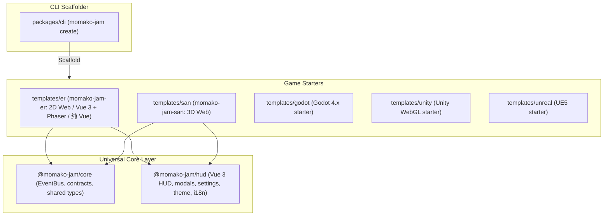

# CODEBASE_STATE.md

> Living registry of everything that currently exists in the `momako-jam` Monorepo — tech stack, architecture, packages, and templates.
> Agent collaboration rules live in [`AGENTS.md`](./AGENTS.md), architecture history in [`docs/DECISION_LOG.md`](./docs/DECISION_LOG.md).

**Current scaffold status:** *Monorepo initialized; core, hud, phaser, san, and cli operational.*
**Last updated:** 2026-11-11 12:33

---

## 1. Monorepo Architecture Overview

---

## 2. Workspace Registry

| Path | Package Name | Role | Tech Stack | Status |
|---|---|---|---|---|
| `packages/core` | `@momako-jam/core` | 跨端事件总线契约、元数据接口 | TypeScript (Zero-dep) | ✅ Built |
| `packages/hud` | `@momako-jam/hud` | 通用 Game Jam UI 库 (组件/Modal/Layout/Store/多语言，提供通用的 home, how-to-play, settings, about-us 页面) | Vue 3, Tailwind v4, Pinia, vue-i18n | ✅ Built |
| `packages/cli` | `@momako-jam/cli` | 极速脚手架 CLI (`npx momako-jam create`) | Node.js ESM | ✅ Functional |
| `templates/er` | `momako-jam-er` | 2D Web 游戏脚手架 (Vue 3 + Phaser 4 / 纯 Vue + HUD，仅包含 pages/game/index.vue) | Vue 3 + Phaser 4 / Vue + HUD | ✅ Built |
| `templates/san` | `momako-jam-san` | 3D Web 游戏脚手架 (声明式 TresJS + HUD，仅包含 pages/game/index.vue) | Vue 3 + TresJS + HUD | ✅ Built |
| `templates/godot` | `momako-jam-godot` | Godot 4 开箱即用工程与 itch.io 预设 | Godot 4.x, GDScript | ✅ Spec ready |
| `templates/unity` | `momako-jam-unity` | Unity 6 / 2022+ WebGL 响应式模板 | Unity 6, C# | ✅ Spec ready |
| `templates/unreal` | `momako-jam-unreal` | Unreal Engine 5 Jam 极速原型模板 | UE5, Blueprints | ✅ Spec ready |

---

## 3. Global Scripts

| Command | Action |
|---|---|
| `pnpm install` | 安装所有工作区依赖并自动建立符号链接 |
| `pnpm -r build` | 全量并行构建 packages 与 templates |
| `pnpm sync:docs` | 校验并同步框架维护者文档与各引擎模板的二开用户文档 (`docs/spec` 等) |
| `pnpm dev:er` | 启动 2D Er 游戏本地开发服务器 |
| `pnpm dev:san` | 启动 3D San 游戏本地开发服务器 |
| `pnpm dev:cli` | 运行本地脚手架测试 |

---

## 4. Layering & Contract Rules

1. **`packages/core`** 是底层纯逻辑库，不依赖任何 UI 框架或具体游戏引擎。
2. **`packages/hud`** 是通用 UI 库，依赖 `@momako-jam/core`，不依赖任何游戏引擎（无论 Phaser 还是 Three.js）。
3. **`templates/*`** 游戏模板引用 `@momako-jam/core` 与 `@momako-jam/hud`，通过 `EVENT_KEYS` 进行双向解耦通信。
4. **`packages/cli`** 负责将 `templates/*` 以及可选包复制生成为独立可交付工程。
