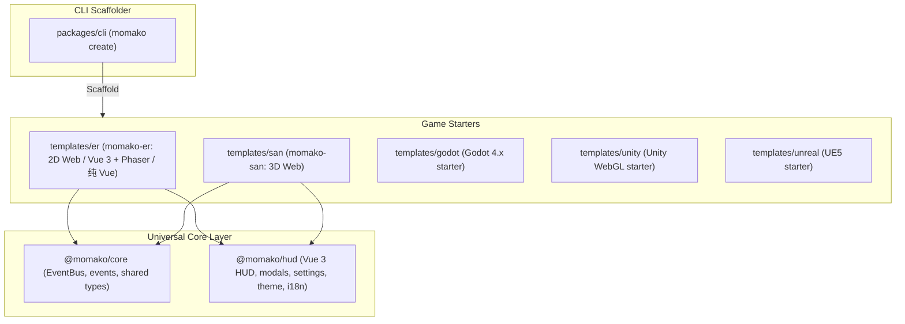

# CODEBASE_STATE.md

> Living registry of everything that currently exists in the `momako` Monorepo — tech stack, architecture, packages, and templates.
> Agent collaboration rules live in [`AGENTS.md`](./AGENTS.md), architecture history in [`docs/DECISION_LOG.md`](./docs/DECISION_LOG.md).

**Current scaffold status:** *Monorepo initialized; core, hud, phaser, san, and cli operational.*
**Last updated:** 2026-11-12 22:50

---

## 1. Monorepo Architecture Overview



---

## 2. Workspace Registry

| Path | Package Name | Role | Tech Stack | Status |
|---|---|---|---|---|
| `packages/core` | `@momako/core` | 跨端事件总线、事件定义与元数据接口 | TypeScript (Zero-dep) | ✅ Built |
| `packages/hud` | `@momako/hud` | 通用 Game Jam UI 库 (组件/Modal/Layout/Store/多语言，提供通用的 home, how-to-play, settings, about-us 页面) | Vue 3, Tailwind v4, Pinia, vue-i18n | ✅ Built |
| `packages/cli` | `momako` | 脚手架 CLI (`npx momako create`)，支持 en / zh / ru / sh 输出，随包携带模板 | Node.js ESM | ✅ Functional |
| `packages/create-momako` | `create-momako` | `npm create momako` 转发包，调用 `momako` | Node.js ESM | ✅ Functional |
| `templates/er` | `momako-er` | 2D Web 游戏脚手架 (Vue 3 + Phaser 4 / 纯 Vue + HUD，仅包含 pages/game/index.vue) | Vue 3 + Phaser 4 / Vue + HUD | ✅ Built |
| `templates/san` | `momako-san` | 3D Web 游戏脚手架 (声明式 TresJS + HUD，仅包含 pages/game/index.vue) | Vue 3 + TresJS + HUD | ✅ Built |
| `templates/godot` | `momako-godot` | Godot 4 开箱即用工程与 itch.io 预设 | Godot 4.x, GDScript | ✅ Spec ready |
| `templates/unity` | `momako-unity` | Unity 6 / 2022+ WebGL 响应式模板 | Unity 6, C# | ✅ Spec ready |
| `templates/unreal` | `momako-unreal` | Unreal Engine 5 Jam 极速原型模板 | UE5, Blueprints | ✅ Spec ready |

---

## 3. Global Scripts

| Command | Action |
|---|---|
| `pnpm install` | 安装所有工作区依赖并自动建立符号链接 |
| `pnpm -r build` | 全量并行构建 packages 与 templates |
| `pnpm sync:docs` | 校验并同步框架维护者文档与各引擎模板的二开用户文档 (`docs/spec` 等) |
| `pnpm dev:er` | 启动 2D Er 游戏本地开发服务器 |
| `pnpm dev:san` | 启动 3D San 游戏本地开发服务器 |
| `pnpm dev:cli` | 运行本地脚手架测试 |

---

## 4. Layering & Communication Standards

1. **`packages/core`** 是底层纯逻辑库，不依赖任何 UI 框架或具体游戏引擎。
2. **`packages/hud`** 是通用 UI 库，依赖 `@momako/core`，不依赖任何游戏引擎（无论 Phaser 还是 Three.js）。
3. **`templates/*`** 游戏模板引用 `@momako/core` 与 `@momako/hud`，通过 `EVENT_KEYS` 进行双向解耦通信。
4. **`packages/cli`** 负责将 `templates/*` 复制生成为独立可交付工程：Web 模板会把 `packages/hud/src` 合并进生成工程的 `src/`（入口为 `src/hud.ts`，导入改写为 `@/hud`），`packages/core/src` 同样生成为 `src/core/`（导入改写为 `@/core`），因为 core 目前仍需要随游戏定制（事件常量、共享类型）。生成工程不依赖任何 `@momako/*` 包。

---

## 5. Web Template Layout (`templates/er`, `templates/san`)

Both web templates share one skeleton. Dependency direction is `router → game / shared`; `shared` never imports `game`; `contents/` holds non-code (low-code) content only and is read by `main.ts` and the HUD pages.

```
src/                          (template source in the monorepo)
├── main.ts  App.vue  style.css
├── router/index.ts
├── game/                     gameplay (owns its own pages/components/scenes/assets)
│   ├── index.ts              barrel (GamePage)
│   ├── pages/index.vue
│   ├── scenes/               er: Phaser scenes (.ts) · san: Tres scene (main-scene.vue)
│   └── components/           san only: ground-grid, player-cube, star-item
├── contents/                 non-code content only
│   └── meta-info/            game/team/hud text per locale, how-to-play/ (<lang>.md + index.ts), OSS credits
└── shared/
    ├── engine/               er only: GameShell around Phaser.Game
    └── runtime/              useGame() session state and EventBus wiring
```

**HUD and core are generated, not installed.** In the monorepo the templates import `@momako/hud` and `@momako/core`. `momako create` installs neither:
- the HUD sources are merged into the generated `src/` (`components/`, `pages/` with home / how-to-play / settings / about-us, `stores/`, `i18n/`, `styles/hud.css`), the HUD barrel becomes `src/hud.ts`, `@momako/hud` imports are rewritten to `@/hud`, and the HUD third-party dependencies (`@vueuse/core`, `lucide-vue-next`, `tailwind-merge`) are added to the project `package.json`;
- the core sources are copied to `src/core/` and `@momako/core` imports are rewritten to `@/core`, because core is not yet flexible enough to be consumed as a fixed dependency.

The generated project has no `@momako/*` dependency. The san output contains no Phaser code, dependency or docs.
