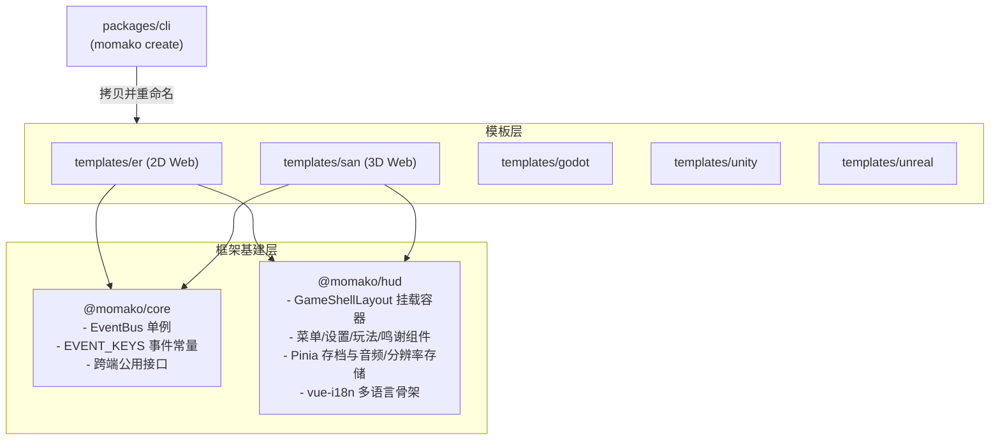

# Momako Monorepo 维护者架构文档

> 供框架贡献者与维护者阅读。二次开发游戏用户请阅读对应模板中的 `docs/`。

---

## 1. 架构拓扑

---

## 2. 核心包职责划分

### `@momako/core`
- **定位**：零依赖纯 TypeScript 基础层。
- **职责**：
  - `GameEventBus`：基于浏览器事件或自建发布订阅机制，解耦 Game Canvas 与 Vue UI。
  - `EVENT_KEYS`：统一事件定义（`score:update`, `round:update`, `game:pause`, `game:resume`, `game:restart`, `game:over`）。
  - 通用接口：`GameMeta`, `TeamInfo`, `SettingsState`, `GameResolution`。
- **红线**：禁止 import 任何 Vue 组件或特定引擎（Phaser / Three.js）类型。

### `@momako/hud`
- **定位**：跨引擎通用的 Game Jam UI 库。
- **职责**：
  - `GameShellLayout`：封装顶部 HUD、右上角暂停按钮、ESC 监听、暂停菜单与游戏内设置 Modal。
  - `SettingsPanel`：集成音量/静音调节、分辨率切换、语言切换。
  - `settingsStore` 与 `saveStore`：基于 Pinia + localStorage 持久化。
- **命名规范**：
  - 文件命名：**除了 `App.vue` 之外，所有 Vue 组件与页面文件一律使用 kebab-case**（如 `game-button.vue`, `home.vue`, `settings.vue`）。
  - Template 引用：**在 Vue 模板中一律使用 PascalCase**（如 `<GameButton>`, `<GameShellLayout>`, `<SettingsPanel>`）。
  - Page 命名：**根页面不加冗余后缀**（如 `home.vue`, `settings.vue`，严禁 `home-page.vue`）。

### `momako`（`packages/cli`）与 `create-momako`
- **定位**：面向开发者的工程生成工具，以无作用域包 `momako` 发布；`create-momako` 是转发到它的薄包装，使 `npm create momako` 可用。
- **命令**：`momako create [name] [-t <id>] [-y] [-f] [--no-git] [--lang <code>]`。
- **职责**：询问项目名与引擎，递归复制模板，重写 `package.json`（名称、版本，并把 `workspace:*` 换成已发布版本）与 `tsconfig.json`（展开仓库根配置、去掉 `@momako/*` 路径），写入 `.gitignore` 与 `AGENTS.md`，并初始化 Git。
- **打包**：`prepack` 把 `templates/*`、`_AGENTS.md`、根 `tsconfig.base.json` 与 core/hud 版本号拷入包内，`postpack` 清理。
- **多语言**：输出支持 `en`、`zh`、`ru`、`sh`，依次按 `--lang`、`MOMAKO_LANG`、系统语言环境选择，缺失词条回退到英文。
